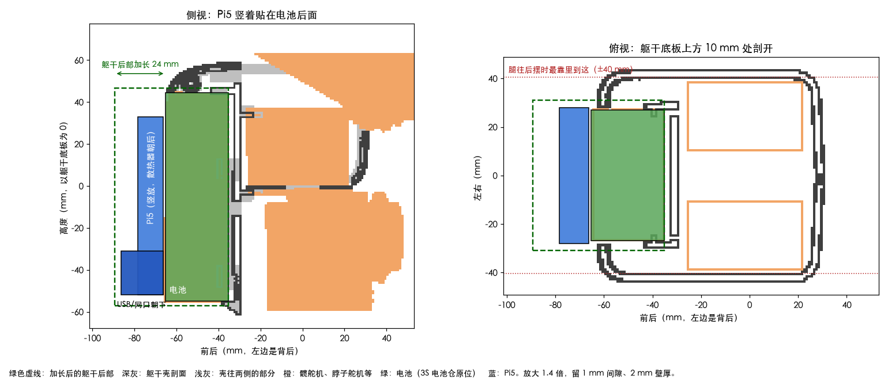

# 大鸭子方案（分支 `big-duck`）

目标：拿 OpenDuckMini 套件里现成的 14 个飞特 ST3215 舵机，照 Microduck（Pollen Robotics）的结构整体放大 1.4 倍，做一只自己的鸭子。主板（树莓派 5）藏在身体里，动作用自己的 4090 / 5090 训练。零件都是买得到的通用件，坏了能换。

这份方案整理自 2026-10-29 的讨论。标了"（算）"的数字是用 Microduck 的 STL 网格算出来的，还没在实物上验证。

## 定下来的事

| 项 | 定为 | 为什么 |
| --- | --- | --- |
| 结构 | Microduck 整体放大 1.4 倍 | 放大 1.35 倍 ST3215 才放得下，但长度方向只剩 1 mm；1.4 倍各方向多出 1.5～2 mm |
| 舵机 | OpenDuckMini 拆下来的 14 个 ST3215-C018（12 V） | 第一阶段嘴巴不动，14 个刚好；以后再加第 15 个 |
| 主板 | 树莓派 5，竖着装在躯干后部、电池后面 | 头不用改；重心低；离电池、舵机驱动板、IMU 都近 |
| 舵机总线 | 微雪 Bus Servo Adapter (A)，USB 接 Pi5 | 套件里现成的，OpenDuckMini 就是用它带 ST3215 |
| IMU | BNO055（套件里的），装在躯干中间 | OpenDuckMini 在 Pi5 上就是用它 |
| 声音 | MAX98357A 功放放背后，喇叭装在头里（Microduck 原来的喇叭位） | 只有两根喇叭线要穿过脖子 |
| 摄像头 | 套件里的树莓派摄像头，排线从头里穿过脖子到背后 | OpenDuckMini 的 Pi5 版也是这样走线 |
| 电池 | 3S 1500 mAh LiPo（套件里的），放在 Microduck 原来的电池仓 | DuckBuddy 用的就是这个规格 |
| 打印 | 拓竹 P2S，PETG，鞋底用 TPU | 最大的件（头顶壳）约 180 mm，P2S 能打 256 mm |
| 建模 | Onshape，画完用 onshape-to-robot 导出仿真模型 | Microduck 和 OpenDuckMini 都是这条路，导出的模型带真实重量 |
| 训练 | xgoduck_rl（mjlab），新加一个 big duck 机器人 | 照现在 XGO Duck 的 HLS1910 配置改 |
| 鸭子上的程序 | 本仓库这个分支：把 UNO Q 的 Bridge 那层换成 Pi5 直接驱动舵机和 IMU | 控制、策略、网页都沿用 |

## 整机参数

| 项 | 数值 |
| --- | --- |
| 身高 | 站立约 38 cm（算） |
| 宽 × 前后 | 约 20 × 17 cm（算） |
| 重量 | 约 1.7～1.9 kg（估算：舵机 14 × 55 g = 770 g，打印件 650～900 g，电池 120 g，Pi5 和其它电子件约 150 g） |
| 关节 | 14 个：两条腿各 5 个，脖子 1 个，头 3 个（点头、转头、歪头）；嘴巴先固定 |
| 力矩 | 膝盖要的力矩约是原版 Microduck 的 3.4 倍；ST3215（30 kg·cm，约 2.9 N·m）是 XL330-M288（约 0.52 N·m）的 5.6 倍，比原版宽裕 |
| 续航 | 估计一直走 20～40 分钟，站着 1～1.5 小时；第 0 阶段用旧鸭子实测 |

## 布局



- **躯干后部**（电池那块）往后加长 24 mm，宽 62 mm。Pi5 竖着放：散热器朝后，背面开散热孔；USB 和网口朝下，底部开口，插线调试用。
- **腿**：髋部不转向、不侧摆、往后踢到底时，腿最靠里到 ±40 mm，离背后这块约 9 mm（算）。转向、侧摆都很大的同时再往后踢会碰到。原版的电池也在这个位置，限制一样。把这块加进仿真的碰撞模型，训练时策略会自己避开。
- **头**：不改，和 Microduck 一样，前脸装摄像头，后脑勺装喇叭。
- 也算过把 Pi5 平放在头顶：头壳中间加高 20 mm 也放得下，但头变重、重心变高，所以没选。

## 零件

### 从 OpenDuckMini 拆下来用

- ST3215-C018 × 14
- 舵机驱动板（微雪 Bus Servo Adapter (A)）+ Type-C 线
- 树莓派 5 + SD 卡
- 树莓派摄像头
- BNO055 IMU
- MAX98357A 功放 + 喇叭（喇叭先量，放不进头里就换 20 mm 的）
- 3S 1500 mAh 电池 + B3 充电器 + 低压报警器
- 5 A 可调降压模块、开关、T 插电源线
- PS4 手柄
- 6804 轴承 × 3
- M3×6、M2×6 自攻等螺丝

用不上的：打印件、校零支架、2 个 SG90、LED、脚底微动开关、OpenDuckMini 扩展板（第一阶段直接接排针）。

### 要买

| 东西 | 数量 | 说明 |
| --- | --- | --- |
| PETG 耗材 | 2 kg | 打印件约 1 kg，另一卷留给试错 |
| TPU 95A 耗材 | 1 卷 | 鞋底、软嘴 |
| 树莓派 5 官方主动散热器 | 1 | 套件里没有的话 |
| Pi5 摄像头排线（22 针转 15 针，50 cm） | 2 | 要从头穿过脖子到背后，一根备用 |
| M3 热熔螺母 | 100 | 打印件之间连接 |
| M3 螺丝套装（6 / 8 / 10 / 12 mm） | 1 盒 | |
| M2×6 自攻螺丝 | 100 | 固定舵机壳，旧的不够时用 |
| 20 mm 8 Ω 1 W 薄喇叭 | 1 | 原配喇叭放不进头里时 |
| 20 AWG 硅胶线、26 AWG 信号线、JST 端子、热缩管、缠绕管 | 若干 | |
| 数显卡尺 | 1 | 没有的话；量尺寸全靠它 |
| T 插功率计 | 1 | 可选，测耗电 |

以后再买：ST3215-C018 × 1（嘴巴）、6701 或 6702 薄轴承 × 1（嘴巴铰点）、INMP441 麦克风 × 2。

## 接线

```
3S 电池 ─T 插─ 开关 ─┬─ 舵机驱动板 DC 输入 ── 舵机总线 ── 右腿 10–14、左腿 20–24、脖子和头 30–33
   │                 └─ 降压模块（空载调到 5.1 V）── Pi5 排针 2、4 脚（5 V），6 脚（GND）
   └─ 平衡头 ── 低压报警器

Pi5 USB ──────────────── 舵机驱动板 Type-C
Pi5 排针 1、3、5、9 ───── BNO055（3.3 V、SDA、SCL、GND），装在躯干中间
Pi5 排针 12、35、40 ───── MAX98357A（BCLK、LRC、DIN；电源接 5 V 和 GND）── 2 根线穿脖子 ── 喇叭
Pi5 摄像头口 ─────────── 50 cm 排线穿脖子 ── 头里的摄像头
```

Pi5 的 `/boot/firmware/config.txt` 加上：

```
dtparam=i2c_arm=on
dtoverlay=max98357a
usb_max_current_enable=1
```

最后一行是因为从排针供电时，Pi5 不知道电源能给 5 A，默认把 USB 口限制在 600 mA。

舵机 ID 沿用 OpenDuckMini 的：10–14 是右腿（髋转向、髋侧摆、髋前后、膝、踝），20–24 是左腿，30 脖子，31 点头，32 转头，33 歪头。以后的嘴巴用 34，和本仓库现在的编号一致。

## 分阶段做

### 第 0 阶段：拆之前（旧鸭子还完整时）

- [ ] 测续航：充满电，让 OpenDuckMini 一直走到低压报警器响，记下时间。有功率计的话，记下走路和站着时各耗多少瓦。
- [ ] 备份 SD 卡镜像。
- [ ] 看一下摄像头板背面的丝印（IMX219 或 OV5647，Pi5 上都能用，记下来就行）。
- [ ] 用卡尺量下面这些，填进表里：

| 要量的 | 结果 |
| --- | --- |
| ST3215 本体长 × 宽 × 高（不含舵盘） | |
| 主舵盘外径、厚度、螺丝孔距 | |
| 从舵盘外径、厚度、螺丝孔距 | |
| 舵机壳安装耳的孔位 | |
| Pi5 + 散热器总厚度（含网口） | |
| 电池长 × 宽 × 厚（含线和插头） | |
| 原配喇叭外形和厚度 | |
| 摄像头板外形、镜头直径 | |
| BNO055 板外形和孔位 | |

### 第 1 阶段：拆 OpenDuckMini

- [ ] 拆之前给每个舵机贴好 ID 标签，ID 不改。
- [ ] 舵盘、螺丝、6804 轴承分类装袋。

### 第 2 阶段：建模（Onshape）

1. **导出参考零件。** 本仓库先切到 `big-duck` 分支，再在电脑上运行（xgoduck_rl 的环境里有 mujoco）：

   ```bash
   cd xgoduck_rl
   uv run python ../xgoduck_runtime_arduino/tools/export-big-duck-reference.py src/mjlab_microduck/robot/microduck/scene_walk.xml ~/big-duck-ref 1.4
   ```

   得到 70 个已经放大并摆好位置的 STL，和每个关节转轴位置、方向的 `joints.csv`。这些网格是 Pollen Robotics 的（CC BY-NC-SA 4.0），只自己用，不要放进这个公开仓库。
2. **导入 Onshape。** 新建一个文档，把所有 STL 导入同一个 Part Studio，当参考件用。
3. **做 ST3215 模型。** 网上找得到 STS3215 的 STEP 模型就直接用，找不到就按第 0 阶段量的尺寸画一个。
4. **外壳直接用放大的**：头顶壳、头底壳、脸、嘴、软嘴、眼睛、身体左右壳、鞋底。只改两处：
   - 身体左右壳和电池托架往后加长 24 mm，做成能放 Pi5 的仓：背面开散热孔，底部开口露出 USB 和网口。
   - 脖子过线的地方开大一点，摄像头排线和喇叭线要能穿过去。
5. **重画承力件**，大约 16 种：trunk_base、motor_support、power_support、yaw2roll、bearing_roll、hip_l、左右 upper_leg、upper_leg_rigidity_plate、leg、左右 ankle、左右 foot、neck、neck_pitch、yaw_roll_motion，banana_pcb_locker 改成 Pi5 支架。规则：
   - 关节转轴的位置和方向按 `joints.csv`，尽量不动；动了就要重新出仿真模型。
   - 髋侧摆、髋前后、膝、踝、歪头：做成 U 形支架，两边分别拧在主舵盘和从舵盘上（M3×6）。原版每个关节配的那个轴承就不用了。
   - 两个髋转向和转头：腿和头整个挂在一个舵盘上，各加一个 6804 轴承。
   - 舵机壳用 M2×6 自攻固定；打印件之间用 M3 热熔螺母加 M3 螺丝。外壳上原来给 M2 的孔放大后约 2.5～3 mm，拧 M3 自攻或穿 M3 螺丝，先打一件试。
   - 嘴巴先做成固定的。
6. **每画完一个零件，导出 STL 发给 Claude**，在仿真里查会不会和别的零件、转动范围冲突。
7. **全部画完后，用 onshape-to-robot 导出 MJCF**，里面带每个零件的重量。

### 第 3 阶段：打印（P2S）

- PETG，0.4 mm 喷嘴，0.2 mm 层高。外壳 2 圈墙、30% 填充（DuckBuddy 的设置）；承力件 4 圈墙、40% 填充。
- 鞋底和软嘴用 TPU，挂在机器背面自带的料盘架上直接进料。
- **先打一条腿**（从髋到脚）试装：舵机装得进、转得动，再打全部。

### 第 4 阶段：装配和接线

- 装舵盘时对准中位（只有一个孔位能正对中线），螺丝上不腐蚀塑料的螺纹胶。
- 降压模块先不接 Pi5，空载调到 5.1 V 再接。
- 线经过每个关节都留弯曲余量，转头先限制在 ±90°。
- 装好后称一下整机，记下重量。

### 第 5 阶段：仿真和训练（4090 / 5090）

- [ ] **ST3215 辨识（BAM）**：一个舵机加一根打印的摆臂和砝码，录数据拟合参数。xgoduck_rl 里给 HLS1910 做过（`robot/xgoduck/params/1910_m6.json`），流程一样。
- [ ] **仿真模型**：先把 Microduck 模型放大 1.4 倍，换上 ST3215 的重量和参数，早点开始训；Onshape 导出后换成导出的模型，重量用实际称的。
- [ ] **xgoduck_rl 里加 big duck 机器人**：照 `xgoduck_constants.py` 写，转头范围限制到 ±90°，背后的 Pi5 仓加进碰撞模型。xgoduck_rl 现在是 LuwuDynamics 的原版克隆，要先在 GitHub 上 fork 一份，或者先在本地建一个 `big-duck` 分支。
- [ ] **训练顺序**：站立 → 走路 → 起身，导出 ONNX。

### 第 6 阶段：鸭子上的程序（本分支）

现在的程序是 UNO Q 的单片机管舵机和 IMU，Linux 这边的 Python 通过 Bridge（`wire.py`）收发数据。Pi5 上没有单片机，所以新写一层：

- 通过 USB 串口直接驱动舵机（飞特协议的同步读写），通过 I2C 读 BNO055。
- 对上提供和现在 Bridge 一样的接口，`controller.py`、`rl_core.py`、`policy.py` 和网页尽量不改。
- OpenDuckMini 在 Pi5 上就是用同样的驱动板和 IMU 跑行走策略，Pi5 带得动。
- 校准页、电量显示沿用。

### 第 7 阶段：上机

1. 吊起来：检查每个关节的零位和方向，一个关节一个关节小幅度动。
2. 放到地上站立，手扶着。
3. 走路：先慢速，接 PS4 手柄。

### 以后

- 第 15 个舵机做会动的嘴巴，铰点加一个 6701 或 6702 薄轴承。
- 麦克风：2 个 INMP441，装在头壳左右开孔的地方。
- 自己画一块小板，把舵机总线、IMU、功放、降压合到一起，替代飞线。

## 分工

| 你 | Claude |
| --- | --- |
| 量尺寸、拆旧鸭子、画 CAD、打印、装配、接线、上机测试 | 导出参考零件（脚本已写好）、检查你画的零件、出仿真模型、写训练配置和辨识脚本、写 Pi5 上的程序、部署 |

## 风险

- **ST3215 比 XL330 慢**，步子会慢一些。第 5 阶段用辨识出来的参数在仿真里确认能走。
- **摄像头排线**穿过 4 个关节，最容易坏：留足弯曲余量，转头限制在 ±90°，备一根排线。
- **Pi5 在背后会热**：装主动散热器，背面开散热孔，跑起来看 `vcgencmd measure_temp`，超过 80 °C 就把孔开大。
- **重量是估算的**：打印完称一下，更新到仿真模型里。
- **版权**：Microduck 的网格是 CC BY-NC-SA 4.0，自己做、自己用没问题；放大后的零件不要卖，也不要传到这个公开仓库里。

## 怎么算出来的

空间检查用的是 xgoduck_rl 里的 microduck 模型（Microduck 的 STL 网格），按倍数放大后切成 1 mm 的小格子：会转的零件按关节范围扫一遍，四周留 1 mm 间隙，再看板子能不能整块放进空的格子里。

- 原样放大时，头里和躯干里都放不下 Pi5（Zero 大小的板子在头里放得下）。
- 头里的空间主要被歪头时转头舵机的摆动占掉：放大 1.35 倍时它扫到转轴上方 31 mm。
- 躯干后部加长 24 mm 后，Pi5 能竖着放在电池后面；头壳加高 20 mm 后，Pi5 也能平放在头顶。
