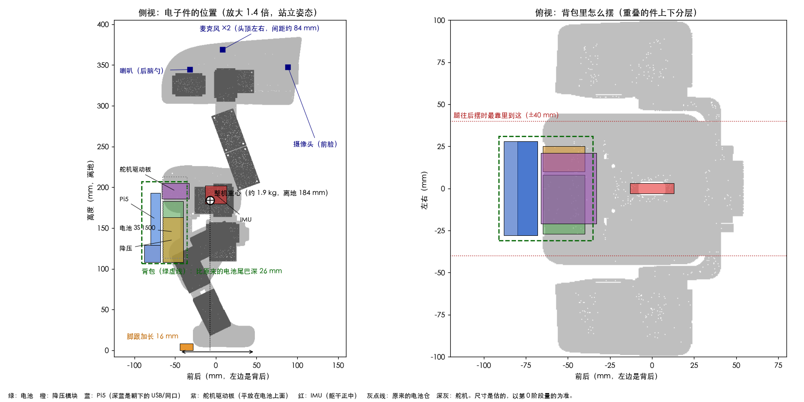

# 大鸭子方案（分支 `big-duck`）

目标：拿 OpenDuckMini 套件里现成的 14 个飞特 ST3215 舵机，照 Microduck（Pollen Robotics）的结构整体放大 1.4 倍，做一只自己的鸭子。主板（树莓派 5）藏在身体里，动作用自己的 4090 / 5090 训练。零件都是买得到的通用件，坏了能换。

这份方案整理自 2026-10-29 的讨论。标了"（算）"的数字是用 Microduck 的 STL 网格算出来的，还没在实物上验证。

## 定下来的事

| 项 | 定为 | 为什么 |
| --- | --- | --- |
| 结构 | Microduck 整体放大 1.4 倍 | 放大 1.35 倍 ST3215 才放得下，但长度方向只剩 1 mm；1.4 倍各方向多出 1.5～2 mm |
| 舵机 | OpenDuckMini 拆下来的 14 个 ST3215-C018（12 V） | 第一阶段嘴巴不动，14 个刚好；以后再加第 15 个 |
| 电子件位置 | 电池、Pi5、降压模块、舵机驱动板、功放全放进加大的背包；IMU 放躯干正中；头里只放摄像头、麦克风、喇叭 | 头轻；重的东西低而集中；电源线最短；一个背盖就能换电池、插线 |
| 造型改动 | 背包比原来的电池尾巴深 26 mm、宽 62 mm、底部低 7 mm；脚跟往后加长 16 mm | 背包装得下所有电子件；脚跟加长让脚掌中心回到重心正下方 |
| 主板 | 树莓派 5，在背包最后面竖着放 | 散热器贴着背盖开孔散热，USB 和网口朝下 |
| 舵机总线 | 微雪 Bus Servo Adapter (A)，USB 接 Pi5 | 套件里现成的，OpenDuckMini 就是用它带 ST3215 |
| 转接板 | OpenDuckMini 的扩展板，插在 Pi5 排针上 | 现成的：电源、IMU、功放都是插头连接，不在排针上飞线；LED、SG90、脚底开关的插座空着。找过现成的 HAT，没有一块能同时管舵机总线、Pi5 供电、IMU、功放和麦克风 |
| IMU | BNO055（套件里的），装在躯干正中两个髋舵机之间 | 最靠近重心；OpenDuckMini 在 Pi5 上就是用它 |
| 声音 | MAX98357A 功放放背后，喇叭装在头里（Microduck 原来的喇叭位）；两个 INMP441 麦克风装在头顶左右 | 功放和麦克风共用 Pi5 的一组 I2S，不走 USB；播放和录音同一个时钟，好做回声消除 |
| 摄像头 | 先用套件里的树莓派摄像头，想看得更广再换 Camera Module 3 Wide；排线从头里穿过脖子到背后 | OpenDuckMini 的 Pi5 版也是这样走线 |
| 电池 | 3S 1500 mAh LiPo（套件里的），竖放在背包靠身体那一格的最下面 | 最重的件放得最低、最靠近身体；DuckBuddy 用的就是这个规格 |
| 打印 | 拓竹 P2S，PETG，鞋底用 TPU | 最大的件（头顶壳）约 180 mm，P2S 能打 256 mm |
| 建模 | Onshape，画完用 onshape-to-robot 导出仿真模型 | Microduck 和 OpenDuckMini 都是这条路，导出的模型带真实重量 |
| 训练 | xgoduck_rl（mjlab），新加一个 big duck 机器人 | 照现在 XGO Duck 的 HLS1910 配置改 |
| 鸭子上的程序 | 本仓库这个分支：把 UNO Q 的 Bridge 那层换成 Pi5 直接驱动舵机和 IMU | 控制、策略、网页都沿用 |

## 整机参数

| 项 | 数值 |
| --- | --- |
| 身高 | 站立约 38 cm（算） |
| 宽 × 前后 | 约 20 × 17 cm（算） |
| 重量 | 约 1.9 kg（估算：舵机 14 × 55 g = 770 g，打印件约 850 g，电池 120 g，Pi5 和其它电子件约 145 g） |
| 重心 | 离地约 184 mm，在脚掌中心后面 9 mm（脚跟加长后），和原版 Microduck 的比例一样（算） |
| 关节 | 14 个：两条腿各 5 个，脖子 1 个，头 3 个（点头、转头、歪头）；嘴巴先固定 |
| 力矩 | 膝盖要的力矩约是原版 Microduck 的 3.4 倍；ST3215（30 kg·cm，约 2.9 N·m）是 XL330-M288（约 0.52 N·m）的 5.6 倍，比原版宽裕 |
| 续航 | 估计一直走 20～40 分钟，站着 1～1.5 小时；第 0 阶段用旧鸭子实测 |

## 布局



腿、髋、脖子、头的结构都不动，只改装电子件的地方和脚跟，这样关节位置还是 Microduck 的，训练模型照样能用。

**头**：结构不改，只放摄像头（前脸）、两个麦克风（头顶左右）、喇叭（后脑勺），越轻越好。

**躯干正中**：BNO055 竖着装在两个髋转向舵机中间的空档里（底板上方 12～34 mm），离重心最近，左右前后都对称。原样放大的躯干里塞满了舵机，舵机驱动板和降压模块都放不下，只有 IMU 和功放这种小板能放进去（算）。

**背包**：把原来挂在后面的电池尾巴做大，所有电子件放在一起。尺寸（以躯干底板 trunk_base 的原点为原点，前为 x、左为 y、上为 z，单位 mm，和导出的参考零件同一个坐标）：

| 东西 | x（前后） | y（左右） | z（上下） | 怎么放 |
| --- | --- | --- | --- | --- |
| 背包外形 | -91 ～ -35 | -31 ～ 31 | -62 ～ 39 | 原来的电池尾巴是 -65 ～ -35、±27、-55 ～ 45 |
| 电池 | -65 ～ -40 | -27 ～ 8 | -60 ～ 15 | 竖放，靠身体那一格的最下面 |
| 降压模块 | -65 ～ -40 | 10 ～ 25 | -60 ～ -5 | 竖放在电池右边 |
| 舵机驱动板 | -66 ～ -33 | -21 ～ 21 | 18 ～ 37 | 平放在电池和降压模块上面，三路舵机线从这里出发 |
| Pi5 | -88 ～ -68 | -28 ～ 28 | -60 ～ 25 | 竖放在最后面，散热器朝后贴着背盖的散热孔，USB 和网口朝下 |
| 功放 | 贴在背包侧壁 | | | 挨着 Pi5 |
| 开关、充电线 | 背包底部 | | | 开关和电池平衡头从底部伸出来 |
| IMU | -13 ～ 13 | -3 ～ 3 | 12 ～ 34 | 在躯干正中，不在背包里 |

这些是按估计的模块尺寸摆的，第 0 阶段量完再调；原则不变：电池最低、最靠身体，Pi5 在最外面好散热，降压模块挨着 Pi5 和电池。

**扩展板**插在 Pi5 上，和散热器一样朝后。算上插好的插头和线的弯，Pi5 这一层估计厚约 30 mm，比上表留的 20 mm 多 10 mm 左右。第 0 阶段量实物，放不下就把背包往后加深，别的件不动，仿真模型跟着改。

**脚**：脚跟往后加长 16 mm（脚长从 76 mm 变成 92 mm）。电子件都放在后面，重心比原版靠后；加长脚跟后，重心落在脚掌中心后面 9 mm，和原版 Microduck 设计的比例一样（算）。

**腿的间隙**：髋部不转向、不侧摆、往后踢到底时，腿最靠里到 ±40 mm，离背包约 9 mm（算）。转向、侧摆都很大的同时再往后踢会碰到。原版的电池也在这个位置，限制一样。把背包和加长的脚都加进仿真的碰撞模型，训练时策略会自己避开。

### 为什么这样摆

都按 1.4 倍、整机约 1.9 kg 估算重心（站立姿态，脚掌原来是前后 -28 ～ 48 mm，中心 10 mm）：

| 摆法 | 重心前后 | 重心高度 | 问题 |
| --- | --- | --- | --- |
| **电子件全在背包，IMU 居中，脚跟加长（选这个）** | -7 mm | 184 mm | 最低；脚跟加长后前后平衡和原版一样 |
| 电池在背包，Pi5 竖在胸前 | 0 mm | 188 mm | 胸前要多一大块，挡脖子往前低头和大腿往前抬 |
| Pi5 在背包，电池在胸前 | 3 mm | 188 mm | 往前摔时电池先着地，锂电池怕撞 |
| Pi5 在头顶（头壳加高 20 mm） | -2 mm | 195 mm | 重心最高，头重，点头、转头时晃得厉害 |
| 电池放到两腿中间最低处 | -1 mm | 184 mm | 两个髋舵机中间只剩约 20 mm 宽，放不下 |

前后差几毫米策略都能学会，所以决定性的是：重心低、头轻、电池不在前面挨摔、电线短、好换电池。

## 摄像头、麦克风、喇叭

都不走 USB，全部接 Pi5 的排针和摄像头口。

| | 方案 | 装在哪 |
| --- | --- | --- |
| 摄像头 | 先用套件里的树莓派摄像头。想看得更广就换 Camera Module 3 Wide（IMX708，水平 102°、自动对焦，25 × 24 × 12.4 mm） | 前脸正中 |
| 麦克风 | 2 个 INMP441 数字麦克风，一个当左声道、一个当右声道，共用一组线 | 头顶左右，间距约 84 mm，以后能听声辨向 |
| 喇叭 | MAX98357A 功放 + 8 Ω 喇叭（套件原配的放不下就用 28 × 40 mm 的薄喇叭） | 功放在背后挨着 Pi5，喇叭在后脑勺 |

- **穿过脖子的线**：摄像头排线 1 根、喇叭线 2 根、麦克风线 5 根（3.3 V、GND、SCK、WS、SD），再加上脖子和头上舵机的总线（3 芯）。
- **功放放在背后**：喇叭线是模拟信号，拉长没关系；I2S 信号线留在背后，不用穿过脖子。
- **麦克风必须在头上**：放背后会离髋部舵机太近，声音也被身体挡住。
- **回声消除**：播放和录音用 Pi5 的同一个 I2S 时钟，以后做"一边说话一边听"时，回声消除好做。
- **为什么不用别的**：USB 声卡和 USB 麦克风阵列你不想要；ReSpeaker 那种 HAT 会把麦克风放在背后的 Pi5 上；树莓派系统自带这些芯片的驱动，不用像 Orange Pi 那样自己配。

## 零件

### 从 OpenDuckMini 拆下来用

- ST3215-C018 × 14
- 舵机驱动板（微雪 Bus Servo Adapter (A)）+ Type-C 线
- 树莓派 5 + SD 卡
- OpenDuckMini 扩展板，和它的 5 V 电源线、IMU 线、音频线
- 树莓派摄像头
- BNO055 IMU
- MAX98357A 功放 + 喇叭（喇叭先量，放不进头里就换 28 × 40 mm 的）
- 3S 1500 mAh 电池 + B3 充电器 + 低压报警器
- 5 A 可调降压模块、开关、T 插电源线
- PS4 手柄
- 6804 轴承 × 3
- M3×6、M2×6 自攻等螺丝

用不上的：打印件、校零支架、2 个 SG90、LED、脚底微动开关和它们的线。

### 要买

| 东西 | 数量 | 说明 |
| --- | --- | --- |
| PETG 耗材 | 2 kg | 打印件约 1 kg，另一卷留给试错 |
| TPU 95A 耗材 | 1 卷 | 鞋底、软嘴 |
| 树莓派 5 官方主动散热器 | 1 | 套件里没有的话 |
| Pi5 摄像头排线（22 针转 15 针，50 cm） | 2 | 要从头穿过脖子到背后，一根备用 |
| M3 热熔螺母 | 100 | 打印件之间连接 |
| M3 螺丝套装（6 / 8 / 10 / 12 mm） | 1 盒 | |
| M2×6 自攻螺丝 | 100 | 固定舵机壳，旧的不够时用 |
| 28 × 40 mm 8 Ω 2 W 薄喇叭 | 1 | 原配喇叭放不进头里时；头里的喇叭位放大后约 35 × 49 × 9.8 mm |
| INMP441 麦克风模块 | 3 | 用 2 个，1 个备用 |
| 细的 6 芯屏蔽线 | 1 m | 麦克风线穿脖子 |
| Camera Module 3 Wide | 1 | 可选：水平视角 102°、自动对焦；套件里的摄像头够用就不买 |
| 20 AWG 硅胶线、26 AWG 信号线、JST 端子、热缩管、缠绕管 | 若干 | |
| 数显卡尺 | 1 | 没有的话；量尺寸全靠它 |
| T 插功率计 | 1 | 可选，测耗电 |

以后再买：ST3215-C018 × 1（嘴巴）、6701 或 6702 薄轴承 × 1（嘴巴铰点）。

## 接线

```
3S 电池 ─T 插─ 开关 ─┬─ 舵机驱动板 DC 输入 ── 舵机总线 ── 右腿 10–14、左腿 20–24、脖子和头 30–33
   │                 └─ 降压模块（空载调到 5.1 V）── 扩展板"5V 电源"插座 ── Pi5
   └─ 平衡头 ── 低压报警器

Pi5 USB ──────────────── 舵机驱动板 Type-C
扩展板"IMU 模块"插座 ──── BNO055，装在躯干中间
扩展板"音频模块"插座 ──── MAX98357A ── 2 根线穿脖子 ── 喇叭
扩展板上焊的 5 芯插头 ──── 6 芯屏蔽线穿脖子 ── 头里 2 个 INMP441（SCK、WS、SD、3.3 V、GND）
Pi5 摄像头口 ─────────── 50 cm 排线穿脖子 ── 头里的摄像头
```

插座的名字是 OpenDuckMini 说明书接线图里标的，电源、IMU、功放的线都用套件原配的，长了就折起来扎好。

**麦克风要焊 5 根线**：扩展板的音频插座只有功放用的输出，没有麦克风要的输入（排针 38 脚，GPIO20）。把扩展板从 Pi5 上拔下来，在它正面露出来的排针焊点上焊 5 根 5 cm 的短线，接一个 5 芯插头（杜邦或 JST 都行），头里来的麦克风线插在这里：

| 排针 | 接麦克风的 |
| --- | --- |
| 17 脚（3.3 V） | VDD（两个麦克风都接） |
| 39 脚（GND） | GND（两个都接） |
| 12 脚（GPIO18） | SCK（两个都接） |
| 35 脚（GPIO19） | WS（两个都接） |
| 38 脚（GPIO20） | SD（两个都接） |

两个麦克风的 L/R 脚一个接 GND（左声道）、一个接 3.3 V（右声道），在头里接好。

数排针：插在 Pi5 上时，1 脚在离 USB 口最远的那一头，单数脚在靠板子中间那排，双数脚在靠板边那排；拔下来之前先用记号笔在 1 脚旁边点一下，焊之前对照 [pinout.xyz](https://pinout.xyz) 再数一遍。12、35 脚的焊点要是被插座挡住，改焊在功放模块的 BCLK、LRC 脚上，是同一根信号。拿不准就拍照发我。

接好以后，从背包出去的线只有：3 路舵机线、IMU 线、喇叭线、麦克风线、摄像头排线；背包里 Pi5 上的线全是插头，换电池、拆 Pi5 都不用动焊点。

Pi5 的 `/boot/firmware/config.txt` 加上：

```
dtparam=i2c_arm=on
dtoverlay=googlevoicehat-soundcard
usb_max_current_enable=1
```

`googlevoicehat-soundcard` 是 Google AIY Voice HAT 的驱动，那块板就是 MAX98357A 加两个 I2S 麦克风，和这里一样，所以功放和麦克风合成一个声卡。它在 Pi5 上能不能直接用还没确认，第 0 阶段先在桌上试。

最后一行是因为从排针供电时，Pi5 不知道电源能给 5 A，默认把 USB 口限制在 600 mA。

舵机 ID 沿用 OpenDuckMini 的：10–14 是右腿（髋转向、髋侧摆、髋前后、膝、踝），20–24 是左腿，30 脖子，31 点头，32 转头，33 歪头。以后的嘴巴用 34，和本仓库现在的编号一致。

## 分阶段做

### 第 0 阶段：拆之前（旧鸭子还完整时）

- [ ] 测续航：充满电，让 OpenDuckMini 一直走到低压报警器响，记下时间。有功率计的话，记下走路和站着时各耗多少瓦。
- [ ] 备份 SD 卡镜像。
- [ ] 看一下摄像头板背面的丝印（IMX219 或 OV5647，Pi5 上都能用，记下来就行）。
- [ ] **桌上试声音和摄像头**，线都用 50 cm 长，和以后穿脖子一样长：
  - Pi5 插上扩展板，MAX98357A 插音频插座，2 个 INMP441 照"接线"焊好；`aplay -l`、`arecord -l` 能看到声卡；放一段声音，录一段左右两路的声音，听有没有杂音、断音。不行就把采样率降到 16 kHz，或者换屏蔽线。
  - 摄像头接 50 cm 排线，`rpicam-hello` 有画面。
- [ ] 用卡尺量下面这些，填进表里：

| 要量的 | 结果 |
| --- | --- |
| ST3215 本体长 × 宽 × 高（不含舵盘） | |
| 主舵盘外径、厚度、螺丝孔距 | |
| 从舵盘外径、厚度、螺丝孔距 | |
| 舵机壳安装耳的孔位 | |
| Pi5 + 散热器 + 扩展板总厚度（含网口和插好的插头）；扩展板压不压散热器的风扇 | |
| 电池长 × 宽 × 厚（含线和插头） | |
| 原配喇叭外形和厚度 | |
| 摄像头板外形、镜头直径 | |
| BNO055 板外形和孔位 | |
| 降压模块外形（含热缩管和线） | |
| 舵机驱动板高度（含接插件；官方板子 42 × 33 mm） | |

### 第 1 阶段：拆 OpenDuckMini

- [ ] 拆之前给每个舵机贴好 ID 标签，ID 不改。
- [ ] 舵盘、螺丝、6804 轴承分类装袋。

### 第 2 阶段：建模（Onshape）

1. **导出参考零件。** 本仓库先切到 `big-duck` 分支，再在电脑上运行（xgoduck_rl 的环境里有 mujoco）：

   ```bash
   cd xgoduck_rl
   uv run python ../xgoduck_runtime_arduino/tools/export-big-duck-reference.py src/mjlab_microduck/robot/microduck/scene_walk.xml ~/big-duck-ref 1.4
   ```

   得到 70 个已经放大并摆好位置的 STL，和每个关节转轴位置、方向的 `joints.csv`。这些网格是 Pollen Robotics 的（CC BY-NC-SA 4.0），只自己用，不要放进这个公开仓库。
2. **导入 Onshape。** 新建一个文档，把所有 STL 导入同一个 Part Studio，当参考件用。
3. **做 ST3215 模型。** 网上找得到 STS3215 的 STEP 模型就直接用，找不到就按第 0 阶段量的尺寸画一个。
4. **外壳直接用放大的**：头顶壳、头底壳、脸、嘴、软嘴、眼睛、身体左右壳、鞋底。只改两处：
   - 按"布局"那张表画背包：身体左右壳和电池托架往后、往下做大，里面分好电池、降压、Pi5、舵机驱动板的位置。背盖可拆（换电池、插线），Pi5 那一面开散热孔，底部开口露出 USB、网口、开关和电池平衡头。背盖外面做成圆弧，别做成平板：仰面摔倒时，平的背盖能让鸭子像乌龟一样稳稳躺住，不好翻身。
   - 脚：foot 和 sole 的脚跟往后加长 16 mm（鞋底一起加长）。
   - 脖子过线的地方开大一点，摄像头排线、喇叭线和麦克风线要能穿过去。
   - 前脸：Microduck 原来装的是 M12 镜头座，改成装树莓派摄像头板（25 × 24 mm）。DuckBuddy 给 IMX219 改过前脸，可以参考。
   - 头顶壳：左右各开一个麦克风孔，间距约 84 mm（DuckBuddy 的位置放大 1.4 倍），孔下面做个小槽把 INMP441 压紧贴住孔。
   - 后脑勺喇叭位开出声孔。
5. **重画承力件**，大约 16 种：trunk_base、motor_support、power_support、yaw2roll、bearing_roll、hip_l、左右 upper_leg、upper_leg_rigidity_plate、leg、左右 ankle、左右 foot、neck、neck_pitch、yaw_roll_motion，banana_pcb_locker 改成 Pi5 支架。规则：
   - 关节转轴的位置和方向按 `joints.csv`，尽量不动；动了就要重新出仿真模型。
   - 髋侧摆、髋前后、膝、踝、歪头：做成 U 形支架，两边分别拧在主舵盘和从舵盘上（M3×6）。原版每个关节配的那个轴承就不用了。
   - 两个髋转向和转头：腿和头整个挂在一个舵盘上，各加一个 6804 轴承。
   - 舵机壳用 M2×6 自攻固定；打印件之间用 M3 热熔螺母加 M3 螺丝。外壳上原来给 M2 的孔放大后约 2.5～3 mm，拧 M3 自攻或穿 M3 螺丝，先打一件试。
   - 嘴巴先做成固定的。
6. **每画完一个零件，导出 STL 发给 Claude**，在仿真里查会不会和别的零件、转动范围冲突。
7. **全部画完后，用 onshape-to-robot 导出 MJCF**，里面带每个零件的重量。

### 第 3 阶段：打印（P2S）

- PETG，0.4 mm 喷嘴，0.2 mm 层高。外壳 2 圈墙、30% 填充（DuckBuddy 的设置）；承力件 4 圈墙、40% 填充。
- 鞋底和软嘴用 TPU，挂在机器背面自带的料盘架上直接进料。
- **先打一条腿**（从髋到脚）试装：舵机装得进、转得动，再打全部。

### 第 4 阶段：装配和接线

- 装舵盘时对准中位（只有一个孔位能正对中线），螺丝上不腐蚀塑料的螺纹胶。
- 降压模块先不接 Pi5，空载调到 5.1 V 再接。
- 线经过每个关节都留弯曲余量，转头先限制在 ±90°。
- 装好后称一下整机，记下重量。

### 第 5 阶段：仿真和训练（4090 / 5090）

- [ ] **ST3215 辨识（BAM）**：一个舵机加一根打印的摆臂和砝码，录数据拟合参数。xgoduck_rl 里给 HLS1910 做过（`robot/xgoduck/params/1910_m6.json`），流程一样。
- [x] **仿真模型**（2026-10-29，xgoduck_rl 本地 `big-duck` 分支 `51168e8`，`robot/bigduck_constants.py`）：加载时从 Microduck 的模型生成，长度放大 1.4 倍，打印件按 2.35 倍加重，舵机换成 55 g 的 ST3215（嘴巴舵机不装），电子件按"布局"那张表放进背包，IMU 在躯干正中，鞋底换成脚跟长 16 mm 的长方体，转头限制在 ±90°。整机 1.89 kg，站立时躯干离地 0.1651 m。Onshape 导出后换成导出的模型，重量用实际称的。
- [x] **走路任务** `Mjlab-Velocity-Flat-BigDuck`：照搬 Microduck 的走路训练，抬脚高度和脚下探测圈按 1.4 倍放大。本机 CPU 上验证过：能建起来，不动时稳稳站住，PPO 能跑。在 4090 上训练：

  ```bash
  uv run train Mjlab-Velocity-Flat-BigDuck --env.scene.num-envs 4096
  ```

  舵机模型现在是**占位**的：用 BAM 自带的 STS3215（7.4 V 版）参数，电压取 6～7 V，让堵转力矩落在 C018 标称的 30 kg·cm 左右。下面的辨识做完就换掉。
- [x] **xgoduck_rl 的 `big-duck` 分支已推到你的 fork** [heminghaoa/xgoduck_rl](https://github.com/heminghaoa/xgoduck_rl/tree/big-duck)（本地 remote 叫 `fork`；`origin` 还是 LuwuDynamics 原版，不往那边推）。4090 那台机器上：`git remote add fork https://github.com/heminghaoa/xgoduck_rl.git`，`git fetch fork`，`git switch big-duck`。
- [x] **每晚自动训练**：4090 那台机器上，每天 01:00 停掉上面的大模型、接着上次的存档训练，08:45 停，大模型随后恢复。脚本 `~/bigduck/nightly-train.sh`，日志在 `~/bigduck/logs/`。
- [x] **第一晚**（2026-10-30，4096 个环境，7 小时 40 分）：练了 31,500 轮，2,000 轮左右就不再涨了。平均奖励约 125，一个回合满 1000 步，平均能撑 980 步以上，约 7% 的回合以摔倒结束。舵机模型还是占位的，同一个任务再练下去意义不大。
- [x] **起身任务** `Mjlab-StandUp-Flat-BigDuck`（xgoduck_rl `5845778`）：照搬 Microduck 的起身训练，开局有四种姿势：趴着、仰面躺着、坐着、站着，练到站直。身高相关的数（目标高度、奖励里的高度门槛、开局高度、身体高低的指令）都按 1.4 倍放大。仰面躺着时身体压在背包上，比照比例放大的 Microduck 高出 24 mm，所以趴着和仰着的开局高度一起抬高 24 mm，免得一开局就卡进地面。本机 CPU 上验证过：能建起来，能训练，开局落地的冲击和 Microduck 相当。从 2026-10-31 凌晨起每晚练它：

  ```bash
  uv run train Mjlab-StandUp-Flat-BigDuck --env.scene.num-envs 4096
  ```

- [ ] **训练顺序**：站立 → 走路 → 起身，导出 ONNX。

### 第 6 阶段：鸭子上的程序（本分支）

现在的程序是 UNO Q 的单片机管舵机和 IMU，Linux 这边的 Python 通过 Bridge（`wire.py`）收发数据。Pi5 上没有单片机，所以新写一层：

- 通过 USB 串口直接驱动舵机（飞特协议的同步读写），通过 I2C 读 BNO055。
- 对上提供和现在 Bridge 一样的接口，`controller.py`、`rl_core.py`、`policy.py` 和网页尽量不改。
- OpenDuckMini 在 Pi5 上就是用同样的驱动板和 IMU 跑行走策略，Pi5 带得动。
- 校准页、电量显示沿用。

### 第 7 阶段：上机

1. 吊起来：检查每个关节的零位和方向，一个关节一个关节小幅度动。
2. 放到地上站立，手扶着。
3. 走路：先慢速，接 PS4 手柄。

### 以后

- 第 15 个舵机做会动的嘴巴，铰点加一个 6701 或 6702 薄轴承。
- 扩展板不够用时（比如加嘴巴舵机、加传感器），再自己画一块小板，把舵机总线、IMU、功放、麦克风、降压合到一起。

## 分工

| 你 | Claude |
| --- | --- |
| 量尺寸、拆旧鸭子、画 CAD、打印、装配、接线、上机测试 | 导出参考零件（脚本已写好）、检查你画的零件、出仿真模型、写训练配置和辨识脚本、写 Pi5 上的程序、部署 |

## 风险

- **ST3215 比 XL330 慢**，步子会慢一些。第 5 阶段用辨识出来的参数在仿真里确认能走。
- **摄像头排线**穿过 4 个关节，最容易坏：留足弯曲余量，转头限制在 ±90°，备一根排线。
- **麦克风线**：I2S 是数字信号，拉到 50 cm 可能出错。第 0 阶段先在桌上用同样长的线试，不行就降采样率或换屏蔽线。
- **Pi5 在背后会热**：装主动散热器，背面开散热孔，跑起来看 `vcgencmd measure_temp`，超过 80 °C 就把孔开大。
- **重量是估算的**：打印完称一下，更新到仿真模型里。
- **版权**：Microduck 的网格是 CC BY-NC-SA 4.0，自己做、自己用没问题；放大后的零件不要卖，也不要传到这个公开仓库里。

## 怎么算出来的

空间检查用的是 xgoduck_rl 里的 microduck 模型（Microduck 的 STL 网格），按倍数放大后切成 1 mm 的小格子：会转的零件按关节范围扫一遍，四周留 1 mm 间隙，再看板子能不能整块放进空的格子里。

- 原样放大时，头里和躯干里都放不下 Pi5（Zero 大小的板子在头里放得下）。
- 头里的空间主要被歪头时转头舵机的摆动占掉：放大 1.35 倍时它扫到转轴上方 31 mm。
- 原样放大的躯干里只放得下 IMU 和功放这种小板（电池、舵机都按实心算）。背包做大 26 mm 后，电池、降压、舵机驱动板、Pi5 都能放进去；头壳加高 20 mm 后，Pi5 也能平放在头顶（没选）。
- 重心用 Microduck 每个零件的重量估算：打印件按放大倍数的 2～3 次方之间（取 2.35 倍）加重，舵机换成 55 g 的 ST3215，再加上电池、Pi5 等电子件。
